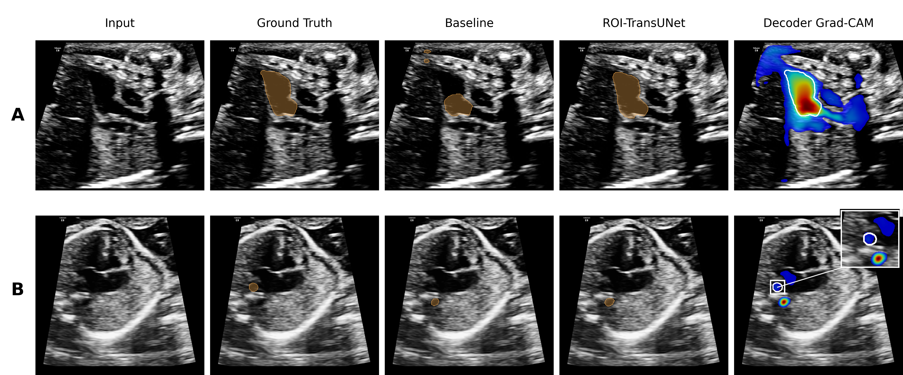

# Soft ROI Refinement for Small-Structure Segmentation in Fetal Cardiac Ultrasound

**Official implementation of ROI-TransUNet.**

[English](README.md) | [简体中文](README_zh-CN.md)


Built on [TransUNet](https://github.com/Beckschen/TransUNet) (R50-ViT-B/16).

| Publication | |
|---|---|
| Title | Soft ROI Refinement for Small-Structure Segmentation in Fetal Cardiac Ultrasound |
| Authors | Rui Wang, Camilla Fazi, Netzahualcoyotl Hernandez-Cruz |
| Venue | IEEE IECBES 2026 *(to appear)* |
| DOI | <!-- TODO: fill in when available --> |

## Overview

Fetal cardiac ultrasound challenges automatic segmentation because small vascular
structures (pulmonary arteries, superior vena cava, trachea) occupy few pixels,
have weak boundaries, and compete with large chambers for a single shared
segmentation head. **ROI-TransUNet** couples an R50-ViT-B/16 TransUNet with a
*soft region-of-interest (ROI) refinement branch*: decoder features, a shallow
image projection, and coarse class probabilities drive a soft localization map
and zero-initialized residual logits for the four weakest structures. The shared
prediction path remains untouched as the fallback, and no inference-time
post-processing is added.

The repository reproduces the full five-stage experiment progression of the
paper — official raw recipe → corrected foreground Dice loss → ImageNet-21K
initialization → tuned Adjusted TransUNet → **+ Soft ROI Refiner** — under one
matched protocol with five fixed training seeds (42, 123, 456, 789, 1024).

## Contributions

- A **soft localization + residual refinement** design for small structures:
  continuous attention instead of a hard ROI crop, with residual heads
  initialized to zero so the baseline logits remain the fallback.
- A **five-seed evaluation** with training-configuration controls, reporting
  95% t-intervals and paired significance tests instead of single-seed claims.
- **Matched comparisons** against U-Net, Attention U-Net, UNet++, and Swin-Unet
  under an identical protocol, covering overlap, boundary, and detection metrics.
- An honest characterization of the method's effect: most of the gain over the
  raw TransUNet comes from the tuned configuration, and the branch itself adds a
  small, interpretable recall–precision trade-off rather than a large uniform gain.

## Method

<p align="center">
  
</p>

- **Soft localization.** The branch combines decoder features, a projected input
  image, and coarse probabilities to predict a sigmoid attention map per weak
  structure — no hard cropping, so localization errors degrade gracefully.
- **Zero-initialized residual heads.** Each weak class (LPA, RPA, SVC, Trachea;
  IDs 8–11) receives a residual logit head initialized to zero: training starts
  exactly at the baseline, and classes 0–7 bypass the branch entirely.
- **Corrected loss.** Training uses 0.2 CE + 0.8 foreground Dice with the
  foreground normalisation corrected (average over the 11 foreground classes,
  fixing the 11/12 scaling error in the original loss).

## Main Results (five seeds, frozen test split)

Mean ± SD across training seeds (Dice/IoU/Recall/Precision/Boundary Dice in %,
HD95/ASSD in pixels, averaged over detected structures):

| Stage | Dice | IoU | Recall | Precision | Boundary Dice | HD95 | ASSD | Detection |
|---|---:|---:|---:|---:|---:|---:|---:|---:|
| Official raw | 68.57 ± 2.44 | 57.32 ± 2.12 | 68.93 ± 2.95 | 74.97 ± 2.00 | 39.25 ± 1.19 | 18.03 | 5.83 | 93.28 |
| Corrected Dice | 69.26 ± 1.16 | 57.83 ± 1.34 | 70.68 ± 1.47 | 74.44 ± 1.27 | 39.37 ± 1.09 | 18.98 | 6.06 | 94.28 |
| ImageNet-21K | 75.28 ± 0.99 | 63.64 ± 1.09 | 75.91 ± 1.87 | 79.51 ± 1.59 | 43.02 ± 1.13 | 12.53 | 4.38 | 97.23 |
| Adjusted TransUNet | 79.76 ± 0.50 | 68.94 ± 0.58 | 79.71 ± 1.05 | 83.19 ± 1.10 | 49.37 ± 0.73 | 10.44 | 3.70 | 98.36 |
| **+ Soft ROI Refiner** | **80.07 ± 0.53** | **69.24 ± 0.63** | **80.64 ± 0.93** | 82.77 ± 1.15 | **49.47 ± 0.78** | 10.61 | 3.73 | **98.58** |

The paired seed-level difference of the ROI Refiner versus the adjusted baseline
is **not** statistically significant (Dice Δ +0.32 pp, p = 0.40); the tables are
therefore presented as a progression with controls, not as evidence of a large
method gain.

Evaluation protocol: the fixed 894-image split (626/89/179 train/val/test) is
never re-partitioned; regional metrics average over the 815 test case–class
pairs where the structure is present in ground truth, and a missed present
structure scores zero. HD95/ASSD average over detected structures only, with
the detection rate reported alongside.

## Qualitative Results

<p align="center">
  
</p>

Two representative cases: the refinement recovers a complete structure that the
baseline under-segments (row A) and sharpens a tiny vessel missed almost
entirely by the baseline (row B), with the decoder Grad-CAM confirming that the
branch attends to the target region.

## Reproduction

```bash
# 1. Clone
git clone https://github.com/Ru1Wang05/Soft_ROI_Refinement.git
cd Soft_ROI_Refinement

# 2. Environment (Python >= 3.8, CUDA recommended)
pip install -r requirements.txt

# 3. Configure local paths (scripts source configs/paths.sh when present)
cp configs/paths.example.sh configs/paths.sh    # set DATA_ROOT, LIST_DIR, PRETRAINED

# 4. Download pretrained encoder weights
bash scripts/00_download_pretrained.sh

# 5. Prepare data — one NPZ per case plus the fixed split lists (see below)

# 6. Run the checks (CPU sufficient)
bash scripts/04_run_tests.sh

# 7. Train — five-stage progression and matched baselines
bash scripts/01_train_progression.sh raw         # official TransUNet recipe
bash scripts/01_train_progression.sh corrected   # + corrected loss
bash scripts/01_train_progression.sh pretrain    # + ImageNet-21k init
bash scripts/01_train_progression.sh adjusted    # Adjusted TransUNet (baseline)
bash scripts/01_train_progression.sh roi         # + Soft ROI Refiner (proposed)
bash scripts/02_train_baselines.sh               # U-Net / AttUNet / UNet++ / Swin-Unet

# 8. Aggregate the paper tables
bash scripts/03_summarize.sh
```

Stages accept seed subsets, e.g. `bash scripts/01_train_progression.sh roi 42 123`;
a single baseline can be trained via `bash scripts/02_train_baselines.sh unet`.

### Expected data layout

```text
$DATA_ROOT/<case>.npz        keys: image (H×W float), label (H×W int, 0–11)
$LIST_DIR/train.txt          fixed split lists, one case name per line
$LIST_DIR/val.txt
$LIST_DIR/test.txt
```

All training shares one entry point, `train.py --model {transunet, roi_refiner,
unet, attunet, unetpp, swinunet}`; evaluation goes through `evaluate.py`
(Dice/IoU/Recall/Precision) and `evaluate_boundary.py` (Boundary Dice, HD95,
ASSD, detection rate, per-case label maps). Default protocol for the main
experiments: 384×384 input, batch 4, 70 epochs, SGD lr 0.01 with polynomial
decay (power 0.9), validation every 2 epochs, checkpoint selected by validation
Dice (`best_dice.pth`), AMP + deterministic mode.

## Repository Structure

```text
├── networks/            TransUNet encoder/decoder, Soft ROI Refiner, CNN baselines
├── datasets/            NPZ dataset and augmentation for the fixed split
├── losses.py            composite losses incl. corrected foreground Dice
├── trainers.py          shared training loops + present-case-class evaluation
├── train.py             unified training entry for all models
├── evaluate.py          regional metrics for one checkpoint
├── evaluate_boundary.py boundary metrics, per-case CSVs and label maps
├── summarize.py         aggregates frozen results into the paper tables
├── tests/run_checks.py  loss/protocol, ROI-mapping and architecture checks
├── scripts/             numbered reproduction entry points (00–04)
├── configs/             portable path configuration template
├── citations/           BibTeX citation export
├── assets/              method and qualitative figures
├── CITATION.cff         machine-readable citation metadata
└── LICENSE              Apache-2.0 (inherited from TransUNet)
```

`tests/` and `configs/` are not needed at inference time; everything else is
part of the reproduction pipeline.

## Data and Checkpoints

The D10 fetal-heart dataset and the trained checkpoints are **not** redistributed.
Users place the preprocessed NPZ cases and the fixed split lists locally and point
`configs/paths.sh` at them; the ImageNet-21k encoder weights are downloaded by
`scripts/00_download_pretrained.sh`.

## Citation

If you use this code, please cite:

```bibtex
@inproceedings{wang2026softroi,
  title     = {Soft ROI Refinement for Small-Structure Segmentation in Fetal Cardiac Ultrasound},
  author    = {Wang, Rui and Fazi, Camilla and Hernandez-Cruz, Netzahualcoyotl},
  booktitle = {IEEE IECBES},
  year      = {2026},
  note      = {To appear}
}
```

A machine-readable record is available in [CITATION.cff](CITATION.cff); a BibTeX
file is provided under [citations/](citations/).

## Acknowledgements

- [TransUNet](https://github.com/Beckschen/TransUNet) (Apache-2.0) — the backbone
  implementation this project builds on.
- [Swin-Unet](https://github.com/HuCaoFighting/Swin-Unet) recipe for the Swin-Unet baseline.

## License

This project inherits the Apache-2.0 license of the TransUNet codebase; see
[LICENSE](LICENSE).

## Medical Disclaimer

This software is released for research purposes only. It has not been approved
for clinical use and is not a substitute for professional medical diagnosis.
