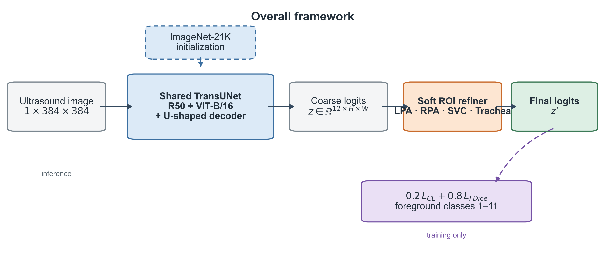

# Soft ROI Refiner for Fetal Cardiac Ultrasound Segmentation

PyTorch implementation of multi-structure segmentation of fetal cardiac ultrasound with
TransUNet and a **Soft ROI Refiner** that targets small, frequently missed structures.

Built on the [TransUNet](https://github.com/Beckschen/TransUNet) (R50-ViT-B/16) codebase.

<p align="center">
  
</p>

## Overview

The D10 fetal-heart dataset contains 512×512 ultrasound frames annotated with 12 classes
(background + 11 anatomical structures). Four structures — the left/right pulmonary arteries,
superior vena cava, and trachea — are small and account for most missed detections.

This repository reproduces the full experiment progression:

1. **Official raw** — the original TransUNet recipe (224 input, 50 epochs, from scratch).
2. **Corrected Dice** — fixes a foreground-Dice normalisation error in the original loss.
3. **ImageNet-21K** — initialises the hybrid R50-ViT encoder with ImageNet-21k weights.
4. **Adjusted TransUNet** — the tuned baseline (384 input, 70 epochs, corrected loss).
5. **Soft ROI Refiner (proposed)** — adds a residual refiner for the four weak structures:
   it combines decoder features, a projection of the input image, and coarse class
   probabilities into soft localisation maps plus residual logits. The residual layer is
   zero-initialised and only modifies classes 8–11; classes 0–7 pass through unchanged.

## Results (five seeds: 42, 123, 456, 789, 1024)

Mean ± SD over training seeds on the frozen test split (present case–class protocol;
HD95/ASSD in pixels, averaged over detected structures):

| Stage | Dice | IoU | Recall | Precision | Boundary Dice | HD95 | ASSD | Detection |
|---|---:|---:|---:|---:|---:|---:|---:|---:|
| Official raw | 68.57 ± 2.44 | 57.32 ± 2.12 | 68.93 ± 2.95 | 74.97 ± 2.00 | 39.25 ± 1.19 | 18.03 | 5.83 | 93.28 |
| Corrected Dice | 69.26 ± 1.16 | 57.83 ± 1.34 | 70.68 ± 1.47 | 74.44 ± 1.27 | 39.37 ± 1.09 | 18.98 | 6.06 | 94.28 |
| ImageNet-21K | 75.28 ± 0.99 | 63.64 ± 1.09 | 75.91 ± 1.87 | 79.51 ± 1.59 | 43.02 ± 1.13 | 12.53 | 4.38 | 97.23 |
| Adjusted TransUNet | 79.76 ± 0.50 | 68.94 ± 0.58 | 79.71 ± 1.05 | 83.19 ± 1.10 | 49.37 ± 0.73 | 10.44 | 3.70 | 98.36 |
| **+ Soft ROI Refiner** | **80.07 ± 0.53** | **69.24 ± 0.63** | **80.64 ± 0.93** | 82.77 ± 1.15 | **49.47 ± 0.78** | 10.61 | 3.73 | **98.58** |

The ROI Refiner yields a small average improvement with an interpretable recall–precision
trade-off on the four target structures; the paired seed-level difference versus the
adjusted baseline is **not** statistically significant (Dice Δ +0.32 pp, p = 0.40), so it
should not be claimed as a significant improvement.

### Dataset and evaluation protocol

| Split | Images | Annotated records |
|---|---:|---:|
| Train | 626 | 3,704 |
| Validation | 89 | 533 |
| Test | 179 | 1,109 |

Splits are fixed and must not be re-partitioned. The main metrics average over the 815
test case–class pairs in which the structure is present in ground truth; a missed present
structure scores zero Dice/IoU/Recall/Precision/Boundary Dice. HD95/ASSD are averaged only
over detected structures, and the detection rate is reported alongside.

Class IDs: 0 background, 1 ascending aorta, 2 descending aorta, 3 left atrium,
4 left ventricle, 5 right atrium, 6 right ventricle, 7 main pulmonary artery,
8 left pulmonary artery, 9 right pulmonary artery, 10 superior vena cava, 11 trachea.

## Installation

```bash
pip install -r requirements.txt   # Python >= 3.8, PyTorch with CUDA
```

## Data preparation

The D10 dataset is not redistributed. Place the preprocessed NPZ cases and the fixed split
lists on your machine and point the scripts at them:

```text
$DATA_ROOT/                 one <case>.npz per case, keys: image (HxW float), label (HxW int)
$LIST_DIR/train.txt         fixed split lists, one case name per line
$LIST_DIR/val.txt
$LIST_DIR/test.txt
```

Copy `configs/paths.example.sh` to `configs/paths.sh` and set `DATA_ROOT` / `LIST_DIR` /
`PRETRAINED` for your machine (all scripts source it when present).

## Usage

```bash
bash scripts/00_download_pretrained.sh            # ImageNet-21k R50+ViT-B/16 weights
bash scripts/04_run_tests.sh                      # unit / smoke tests (CPU ok)

# main progression, five seeds each:
bash scripts/01_train_progression.sh raw          # official TransUNet recipe
bash scripts/01_train_progression.sh corrected    # + corrected loss
bash scripts/01_train_progression.sh pretrain     # + ImageNet-21k init
bash scripts/01_train_progression.sh adjusted     # Adjusted TransUNet (baseline)
bash scripts/01_train_progression.sh roi          # + Soft ROI Refiner (proposed)

bash scripts/02_train_baselines.sh                # U-Net / AttUNet / UNet++ / Swin-Unet
bash scripts/03_summarize.sh                      # aggregate paper tables
```

Optional arguments: `01_train_progression.sh <stage> 42 123` trains specific seeds;
`02_train_baselines.sh unet` trains a single architecture.

Additional utilities:

- `evaluate_fetalheart_final_models.py` — Dice/IoU/Recall/Precision for one checkpoint.
- `eval_boundary_search.py` — Boundary Dice, HD95, ASSD, detection rate, per-case CSVs and label maps.
- `dump_test_confusion.py` — pixel-level confusion matrices.
- `make_final_qualitative_figure.py` — qualitative comparison panels for the four target structures.
- `prepare_fetalheart_view_metadata.py` — case-to-view metadata from the fixed split.

Default training configuration (Adjusted TransUNet): 384×384 input, batch 4, 70 epochs,
SGD lr 0.01 with polynomial decay (power 0.9), 0.2 CE + 0.8 corrected foreground Dice,
validation every 2 epochs, checkpoint selected by validation Dice (`best_dice.pth`),
AMP and deterministic mode enabled.

## Repository structure

```text
├── networks/            TransUNet encoder/decoder, Soft ROI Refiner, CNN baselines
├── datasets/            NPZ dataset and augmentation for the fixed D10 split
├── losses_fetalheart.py composite losses incl. corrected foreground Dice
├── trainer_fetalheart*.py  shared training loop and ROI-Refiner trainer
├── train_fetalheart_*.py   training entry points (raw / factorial / opt / baselines / roi)
├── evaluate_*.py, eval_boundary_search.py, summarize_*.py   evaluation and aggregation
├── tests/               unit and smoke tests
├── scripts/             portable reproduction entry points (00–04)
├── configs/             path configuration template
└── assets/              method figure
```

## Acknowledgements

- [TransUNet](https://github.com/Beckschen/TransUNet) (Apache-2.0) — the backbone
  implementation this project builds on.
- [Swin-Unet](https://github.com/HuCaoFighting/Swin-Unet) recipe for the Swin-Unet baseline.

## License

This project inherits the Apache-2.0 license of the TransUNet codebase; see [LICENSE](LICENSE).
